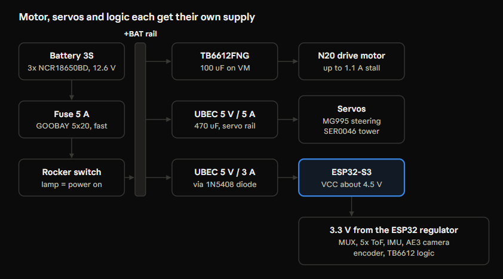
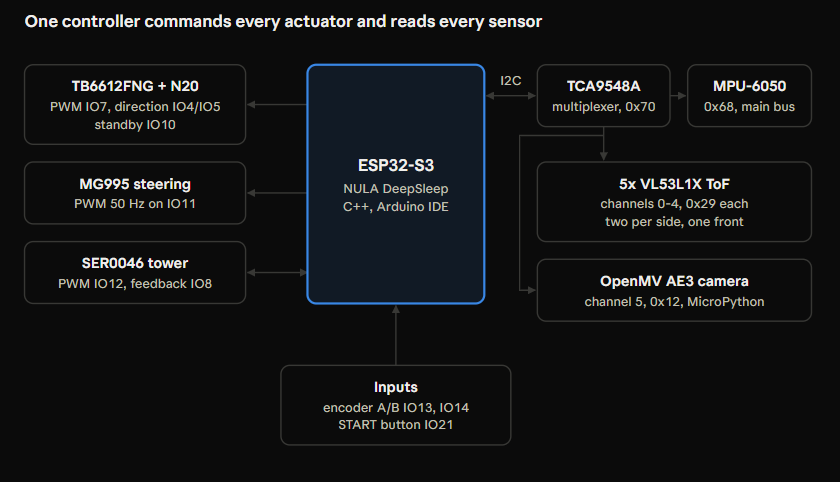
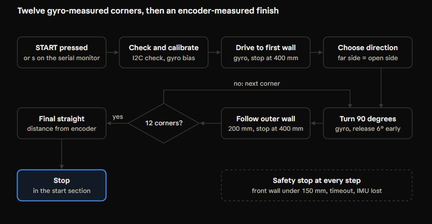

# Controlled C.H.A.O.S. v2 — Technical Specification

## 1. Overview

Controlled C.H.A.O.S. v2 is a custom-built autonomous vehicle for the WRO 2026 Future Engineers International Final in San Juan, Puerto Rico (8–10 December 2026). It replaces the LEGO Spike Prime robot that won the Croatian national final, while keeping its proven control ideas.

This document specifies the hardware as built: mechanics, power, sensors, electronics and fabrication. The competition software and the course strategy are deliberately left open (section 7); they are written by the team members.

**Team C.H.A.O.S. Josipovac** (Udruga C.H.A.O.S., Osijek, Croatia): Mateo Štefanek, Leon Žlender, Ognjen Malinić; coach Krunoslav Štefanek.

### Platform at a glance

| Subsystem        | v2 solution                                                                              |
| ---------------- | ---------------------------------------------------------------------------------------- |
| Controller       | Soldered NULA DeepSleep ESP32-S3, programmed in Arduino IDE (C++)                        |
| Vision           | OpenMV AE3 camera on a rotating tower, MicroPython                                       |
| Drive            | One Waveshare N20 12 V 1:150 motor with Hall encoder → LEGO differential → rear wheels |
| Steering         | MG995 servo, 3D-printed Ackermann linkage                                                |
| Distance sensing | 5× VL53L1X time-of-flight sensors via a TCA9548A I²C multiplexer                       |
| Heading          | MPU-6050 gyroscope                                                                       |
| Power            | 3× Panasonic NCR18650BD in series (3S, 12.6 V full), fuse, two 5 V UBECs                |
| Chassis          | 3D-printed three-deck frame, 100 mm wheelbase, LEGO wheels Ø 62.4 mm                    |

### How we got here

The project evolved in three steps since the national final. Each step kept the control logic and changed only the platform.

| When                | Step                                                                                    | Why                                                                                                                                   |
| ------------------- | --------------------------------------------------------------------------------------- | ------------------------------------------------------------------------------------------------------------------------------------- |
| Nov 2026            | ESP32-S3 + AE3 platform assembled and wired; connection list verified line by line      | Final hardware for the International Final                                                                                            |
| Oct - Nov 2026      | Custom 3D-printed chassis, iterations v0.1–v0.12                                       | Compact layout, own parts, Ackermann steering                                                                                         |
| Oct 2026            | Spike Prime and Raspberry Pi concept dropped for ESP32-S3 + OpenMV AE3                  | Fewer boards, AE3 more capable than H7, solder-free Qwiic wiring, parts from a local supplier, better precision that LEGo SPike Prime |
| Sep–Oct 2026       | Concept: Raspberry Pi 5 + Pico 2 + OpenMV H7, VL53L0X, MPU-6050, Pololu motor + DRV8871 | First custom-platform design, list of materials and wiring                                                                            |
| Jun 2026            | v1 code published on GitHub                                                             | LEGO Spike Prime + OpenMV H7 via PUPRemote, ultrasonic wall following                                                                 |
| 2026 national final | v1 wins the Croatian Future Engineers final                                             | Qualification for the International Final                                                                                             |

Ideas that we planned to carry over from v1: colour classification by 50-sample majority vote, proportional wall following, and corner entry triggered by a trimmed-mean front distance. All of it was dependant on our new design and sensor reactions which we didn't knew at the time when planning of transition was made.

## 2. Rules compliance

v2 meets every vehicle rule of the WRO 2026 Future Engineers General Rules:

| Rule (WRO 2026 FE)  | Requirement                                                       | v2                                                                                                                                           | Status                          |
| ------------------- | ----------------------------------------------------------------- | -------------------------------------------------------------------------------------------------------------------------------------------- | ------------------------------- |
| 11 Size             | ≤ 300 × 200 × 300 mm (L × W × H), unchanged during the round | Height 290 mm (camera mast shortened after the change to Ø 62.4 mm wheels); length and width to be re-measured; nothing extends or retracts | Meets; re-measure assembled     |
| 11 Mass             | ≤ 1.5 kg                                                         | Not yet weighed                                                                                                                              | Open                            |
| 11 Wheels           | 4 wheels, one drive axle, one steering actuator                   | 4 LEGO wheels Ø 62.4 mm; rear drive axle; one MG995 steering servo                                                                          | Meets                           |
| 11 Drive            | Driven wheels physically linked; no electronic differential       | One N20 motor → one LEGO mechanical differential → both rear wheels                                                                        | Meets                           |
| 11 Forbidden wheels | No omni, ball or spherical wheels                                 | None                                                                                                                                         | Meets                           |
| 11 Wireless         | No RF, Bluetooth or Wi-Fi during rounds; judges may inspect code  | ESP32-S3 radio must be switched off in code; all links are wired (I²C, PWM, GPIO)                                                           | Open: show the line in the code |
| 9 Start             | One power switch; one start button; no data input at the table    | Illuminated rocker switch + red START button; placement jig gives a fixed start pose                                                         | Meets                           |

Parking lot length is 1.5 × the vehicle length measured within 10 cm of the floor (Q&A 2026). With a 100 mm wheelbase and Ø 62.4 mm wheels the footprint is at least 162 mm long, so the lot is at least about 243 mm long and 200 mm wide; the exact figure follows from the re-measured length.

## 3. Mobility and mechanics

The vehicle is a rear-wheel-drive, front-steered car on a 100 mm wheelbase, stacked in three decks to stay short  while carrying a 290 mm camera tower.

### 3.1 Layout

| Deck         | Contents                                                                                                                                                                   |
| ------------ | -------------------------------------------------------------------------------------------------------------------------------------------------------------------------- |
| Bottom plate | MG995 steering servo (mounted upside down), steering knuckles and tie rods, TCA9548A multiplexer with the MPU-6050 on its own plate above it, rear drive module underneath |
| Battery deck | 3×18650 holder, side ToF sensors                                                                                                                                          |
| Top deck     | Power-distribution perfboard in a printed adapter, ESP32-S3 on 16 mm standoffs, UBECs, main switch, START button, camera mast                                              |

| Dimension           | Value                                                                                          |
| ------------------- | ---------------------------------------------------------------------------------------------- |
| Overall L × W × H | L and W to be re-measured; H 290 mm (mast shortened to keep the height after the wheel change) |
| Wheelbase           | 100 mm                                                                                         |
| Track               | 110 mm                                                                                         |
| Wheels              | LEGO Ø 62.4 mm, circumference π × 62.4 = 196.0 mm (changed from 43.2 mm wheels)             |

The first concept (v0.1) had a 130 mm wheelbase and was 204 mm long. Stacking the parts vertically cut the length by 55 mm; we accepted a taller centre of gravity in exchange, and keep the battery low to compensate.

### 3.2 Drivetrain

One Waveshare N20 12 V gear motor (1:150, Hall encoder) drives an old-type LEGO differential through a 24-tooth / 24-tooth gear pair (1:1). The differential splits torque mechanically between the rear wheels, which satisfies the rule that driven wheels must be physically linked.

The motor and gears sit in a separate printed drive module, fixed to the bottom plate with 4× M3 from below. The N20 slides into a 12 × 10 mm tunnel (0.3 mm clearance per side) from the rear up to a stop, and one M3 screw clamps the gearbox. Making the module separate lets us reprint only this part when we change the gearing.

**Speed estimate.** Rated no-load speed is 200 rpm at 12 V ([Waveshare](https://www.waveshare.com/wiki/DCGM-N20-12V-EN-200RPM)). With the 1:1 pair the wheels turn at motor-output speed:

$$
v_{0} = \frac{n \cdot \pi d}{60} = \frac{200 \cdot 0.1960\ \text{m}}{60} \approx 0.65\ \text{m/s}
$$

At the nominal pack voltage of 10.8 V the no-load speed drops to about 0.59 m/s; under load we expect 0.45–0.55 m/s, to be confirmed with the encoder. One lap on the 1000 mm corridor centreline is about 8 m, so three laps take roughly 45–55 s of driving of the 180 s round, plus the stops before corners. If more speed is needed, a 24 → 16 LEGO tooth pair could be an option as a replacement version.

**Torque estimate.** Stall torque is at least 1.2 kg·cm (0.118 N·m). At the wheel radius of 31.2 mm:

$$
F_{max} = \frac{\tau}{r} = \frac{0.118\ \text{N·m}}{0.0312\ \text{m}} \approx 3.8\ \text{N}
$$

Even at the 1.5 kg mass limit this allows about 2.5 m/s² of acceleration before losses, far more than the course needs; the real limit is rear-wheel grip.

**Odometry.** The encoder gives 1050 channel-A pulses per output-shaft revolution (7 PPR × 150), so one pulse is about 0.19 mm of travel. Pulses per wheel revolution are still bertter to be measured on the assembled vehicle, because the differential averages the two wheels.

### 3.3 Steering

The MG995 servo sits upside down with its output shaft on the front-axle line and drives both knuckles through tie rods arranged for Ackermann geometry. Ackermann steering is optional under the rules; early v2 sketches used simple parallel steering as we had on Spike Prime first version, but we expected the inner front wheel to scrub and slip in tight turns, so v2 keeps an Ackermann linkage as v1 had in Croatian Finals. For a turn of radius R (measured to the middle of the rear axle) with wheelbase L and track W, the ideal angles are:

$$
\tan\delta_{in} = \frac{L}{R - W/2}, \qquad \tan\delta_{out} = \frac{L}{R + W/2}
$$

Example: for R = 300 mm, L = 100 mm and W = 110 mm, the inner wheel needs 22.2° and the outer 15.7°.

The linkage was checked in CAD for a free sweep of ±35° without screw heads hitting the plate; the whole steering group is raised 6 mm for 7 mm of clearance under the lowest tie rod. At 35° the bicycle-model minimum turning radius is R = L / tan 35° ≈ 143 mm. In practice the servo limits set the angle:

| Steering calibration (measured) | Servo angle |
| ------------------------------- | ----------- |
| Straight                        | 73°        |
| Full left (limit)               | 55°        |
| Full right (limit)              | 90°        |

The change from 43.2 mm to Ø 62.4 mm wheels kept both axles in place, but reduced the maximum steering angle the vehicle had with the smaller wheels.&#32;

## 4. Power

One 3S Li-ion pack feeds three separated rails: the battery rail for the drive motor, a 5 V servo rail and a 5 V logic rail, so a servo current spike cannot reset the controller.

Everything after the switch hangs off the +BAT rail; all grounds meet at one star point on the perfboard.

### 4.1 Battery

| Property   | Value                                                                                                                       |
| ---------- | --------------------------------------------------------------------------------------------------------------------------- |
| Cells      | 3× Panasonic NCR18650BD, in series, in a 3×18650 holder                                                                   |
| Voltage    | 12.6 V full, 10.8 V nominal, 9.0 V empty (3.0 V per cell)                                                                   |
| Protection | No BMS in the cells or holder; protection is the 5 A fuse right after the battery                                           |
| Charging   | Cells are taken out and charged on a separate 18650 charger; each cell is checked at 4.15–4.20 V and matched within 0.05 V |

This pack replaced two earlier options: a 3S LiPo (no fixed mounting, needs a balance charger) and two used "9800 mAh" 18650 cells of unknown condition. New brand-name cells give a known capacity, and three cells reach 12 V for the 12 V motor.

### 4.2 Distribution

| Rail                          | Source                                                                  | Feeds                                                                    | Protection / filtering                                   |
| ----------------------------- | ----------------------------------------------------------------------- | ------------------------------------------------------------------------ | -------------------------------------------------------- |
| +BAT (11.0–12.6 V)           | Battery → 5 A fast fuse (GOOBAY 5×20 mm) → illuminated rocker switch | TB6612FNG VM → N20 motor; both UBEC inputs                              | 100 µF / 50 V at VM; 100 nF across the motor terminals  |
| Servo 5 V (4.9–5.2 V)        | UBEC 5 V / 5 A                                                          | MG995 steering servo, SER0046 tower servo                                | 470 µF close to the servo headers                       |
| Logic 5 V (4.4–4.6 V at VCC) | UBEC 5 V / 3 A → 1N5408 diode → ESP32 VCC                             | ESP32-S3                                                                 | Diode blocks back-feed from the laptop USB into the UBEC |
| 3.3 V                         | ESP32 on-board regulator                                                | TB6612 logic, encoder, all Qwiic devices (MUX, 5× ToF, IMU, AE3 camera) | —                                                       |

All grounds meet at one star point on the perfboard. The diode was added after a laptop USB port reported a power surge while USB and battery were connected together; it costs about 0.5 V on the logic rail but lets us program the robot with the battery on.

### 4.3 Power budget

The estimated worst case is about 2.6 A from the battery, below the 5 A fuse according to parts documentation; a 3-minute round uses only a few percent of the pack checked manually after our test drives. This kind of battery power showed to be quite reliable for this design for us.

| Load                       | Rail      | Typical         | Peak ( as per item documentation) |
| -------------------------- | --------- | --------------- | --------------------------------- |
| N20 motor                  | +BAT      | 0.1 A (no load) | 1.1 A (stall)                     |
| MG995 steering servo       | Servo 5 V | 0.5 A (approx.) | > 1 A (stall)                     |
| SER0046 tower servo        | Servo 5 V | 0.3 A (approx.) | >0.8 A (stall)                    |
| ESP32-S3 + all 3.3 V loads | Logic 5 V | about 0.3 A     | —                                |

## 5. Sensors and camera

Geometry comes from five time-of-flight sensors and a gyroscope; colour comes from one camera that scans the whole course from a rotating tower before the vehicle starts driving.

### 5.1 Time-of-flight sensors

| Position      | MUX channel | Purpose                                     |
| ------------- | ----------- | ------------------------------------------- |
| Right-front   | 0           | Distance and angle to the right wall        |
| Right-rear    | 1           | Distance and angle to the right wall        |
| Left-front    | 2           | Distance and angle to the left wall         |
| Front, centre | 3           | Corner approach, distance to the wall ahead |
| Left-rear     | 4           | Distance and angle to the left wall         |

All five are Soldered VL53L1X boards with easyC/Qwiic connectors. They share the fixed address 0x29, so each sits on its own channel of a TCA9548A multiplexer. The side sensors face perpendicular to the body.

Two sensors per side give both the distance to the wall and the vehicle's angle to it. With s the spacing between the front and rear sensor along the body:

$$
\theta = \arctan\frac{d_{front} - d_{rear}}{s}, \qquad d_{wall} = \frac{d_{front} + d_{rear}}{2}\cos\theta
$$

One sensor per side (as in v1 with ultrasonics) cannot tell "close to the wall" from "angled towards the wall". We considered a sixth sensor angled 45° forward for corner detection and set it aside; the front sensor and the IMU heading cover corners.

Compared with v1's ultrasonic sensors and the VL53L0X of the Raspberry Pi concept, the VL53L1X has a longer range (up to 4 m) than the 1000 mm corridor needs, and works on the same I²C bus as everything else. Just to mention, up to 4m range varries about light conditions and position of the sensor. We had to re-calibrate our first version as we didn't take in calculation that with toF's wide angle of 27° and front sensor only 4 cm of the ground, it detects the surface of the track on about 16 cm in front of it. Finally, that showed on the track, but on the table where we did the testing, and with mat surface, that problem was not existent. (!)

**Calibration and checks.** Each sensor is checked against a card at 100, 200 and 500 mm; the target is ±10 mm. For the best result, we decided to use the short option parameter for VL53l1X as medium, and long, have a larger distance covering, but also are less dependant on the environment conditions and slower in getting back the result.

### 5.2 Gyroscope

An MPU-6050 (address 0x68) gives the heading by integrating the Z-axis rate. It is mounted flat, chip up, X axis forward, on its own plate above the multiplexer, and connected to the multiplexer's pass-through port on the main bus. The vehicle must stay still for 2 s after power-up while the gyro bias is measured; the target is less than 1° of drift in 30 s at rest.

### 5.3 Camera and tower

The OpenMV AE3 (31 × 31 × 9 mm) sits in a printed fork at the top of the mast, about 290 mm above the floor, tilted 15° down. The mast is centred across the vehicle's width and placed as close as possible to the  center of the parking lot. The camera is an I²C device at address 0x12 on multiplexer channel 5 and is powered through the same Qwiic cable.

**Course scan.** Inspired by teams with similar approach through the former years, the vehicle scans the whole course from the start position before moving, so the route is decided before driving. A placement jig puts the vehicle in exactly the same spot every time, whatever the driving direction, so the camera angles map to fixed course positions.

The position itself was moved around as we did the design process so we had few solutions, but the "same spot from the parking" was the best option for us. Scanning the area from just 1-2cm off the spot asks to do separate mapping of obstacle's position depending on it.

**Tower servo.** The first tower used an SG90 servo, but its 180° range could not cover the scan for both driving directions. We weighed LEGO 1:2 gearing and a 28BYJ-48 stepper, and chose a SER0046 270° servo with an analog position-feedback wire instead: no extra gears, and the controller can read the real angle.

| Tower calibration (measured) | Value                                      |
| ---------------------------- | ------------------------------------------ |
| Range                        | 0–270° (500–2500 µs)                   |
| Centre (camera forward)      | 135°                                      |
| Feedback at 135°            | 1517 mV                                    |
| Feedback slope               | 10.14 mV per degree, linear over 90–270° |

**Handshake.** The ESP32-S3, not the camera, drives the tower servo. It moves the tower, waits until the feedback voltage shows the target angle, then tells the camera which angle number it is at; the camera answers when it has finished with that view and is ready for the next.

**Colour calibration.** Targets from the 2026 rules are red pillars RGB (238, 39, 55), green pillars RGB (68, 214, 44), magenta parking walls RGB (255, 0, 255), orange and blue corner lines. On-site colours can differ, and calibration is allowed only during practice time, so exposure, gain and white balance are fixed in the camera code after calibration. The AE3's own built-in ToF and IMU are available but not used.

## 6. Electronics and wiring

The ESP32-S3 drives the motor and both servos directly and reads every sensor and the camera over one I²C bus split by the multiplexer; t. The as-built wire list in the connection list (added as a file to this repository).

Actuators are driven by direct PWM and GPIO lines; every sensor and the camera sit on one I²C bus behind the multiplexer.

### 6.1 ESP32-S3 pin map

| Pin   | Function                       | Connected to          | Direction                           |
| ----- | ------------------------------ | --------------------- | ----------------------------------- |
| IO4   | Motor direction                | TB6612 AIN1           | Output                              |
| IO5   | Motor direction                | TB6612 AIN2           | Output                              |
| IO7   | Motor speed                    | TB6612 PWMA           | PWM 20 kHz                          |
| IO8   | Tower position feedback (ADC1) | SER0046 feedback wire | Analog input                        |
| IO10  | Driver enable                  | TB6612 STBY           | Output                              |
| IO11  | Steering servo                 | MG995 signal          | PWM 50 Hz                           |
| IO12  | Camera tower servo             | SER0046 signal        | PWM 50 Hz                           |
| IO13  | Encoder A                      | N20 encoder A         | Interrupt input                     |
| IO14  | Encoder B                      | N20 encoder B         | Input                               |
| IO21  | START button                   | Button to GND         | Input, pull-up                      |
| Qwiic | I²C bus                       | Multiplexer input     | SDA/SCL GPIO numbers to be recorded |

The pins avoid the ESP32-S3 boot strapping pins (0, 3, 45, 46), USB (19, 20), flash and PSRAM (26–37) and the serial port (43, 44). The tower feedback input is on ADC1, which keeps working with the radio off or on (must be off during the rid). I²C must be started with the explicit Qwiic pin numbers, not a plain `Wire.begin()`. The board's BAT/JST Li-ion input is not used; the controller is fed only through VCC. IO47 is spare.
Electronics_and_wiring_6.png
### 6.2 I²C map

| Address | Device                                 | Where                                           |
| ------- | -------------------------------------- | ----------------------------------------------- |
| 0x70    | TCA9548A multiplexer                   | Main bus                                        |
| 0x51    | Real-time clock on the NULA board      | Main bus                                        |
| 0x68    | MPU-6050 gyroscope                     | Main bus, via the multiplexer pass-through port |
| 0x29    | VL53L1X × 5                           | Multiplexer channels 0–4                       |
| 0x12    | OpenMV AE3 (set by the camera program) | Multiplexer channel 5                           |

Channels 6 and 7 are free for a future sensor.

### 6.3 Motor driver

The SparkFun TB6612FNG replaced the DRV8871 of the earlier concept. It runs its logic at 3.3 V from the controller, takes the motor supply (VM) straight from the battery rail, and has a standby pin, so the motor can be cut in software (STBY = 0) independent of the PWM signal. One channel (about 1.2 A continuous) covers the N20's 1.1 A stall current.

### 6.4 Start and status

The illuminated rocker switch is the only power switch, and its lamp shows when the vehicle is powered. The red 16 mm START button is the only input at the start; its LED terminals are not connected, and the on-board RGB LED of the NULA board shows the vehicle's state if needed.

## 7. Software architecture&#32;

### 7.1 Toolchain

| Target                    | Language    | Tool                                                        |
| ------------------------- | ----------- | ----------------------------------------------------------- |
| ESP32-S3 (NULA DeepSleep) | C++         | Arduino IDE 2.x, Espressif ESP32 core 3.x, CH340 USB driver |
| OpenMV AE3                | MicroPython | OpenMV IDE                                                  |

All pin numbers and constants live in one file, `includes/includes.ino` (formerly ChaosPins.h), included by every sketch. Bench test sketches exist for each subsystem: `hello`, `battery`, `motor_test`, `servo_center`, `servo_``t``ower`, `i2c_scan` ,`butto``n` , `pref``light` and `OpenMV_camera_test`.

### 7.2 Split of responsibilities

| Processor  | Does                                                                                                   |
| ---------- | ------------------------------------------------------------------------------------------------------ |
| ESP32-S3   | Start sequence, motor and encoder, steering, tower servo, ToF and IMU reading, decisions while driving |
| OpenMV AE3 | Image capture and colour detection, answers the ESP32-S3 over I²C at 0x12                             |

### 7.3 Modules&#32;

| Module      | Responsibility                                          |
| ----------- | ------------------------------------------------------- |
| Drive       | PWM speed, direction, encoder odometry                  |
| Steering    | Angle → servo with the 55–90° limits                 |
| Sensing     | Multiplexer channel switching, 5× ToF, IMU heading     |
| Camera link | I²C protocol with the AE3, tower handshake             |
| Course scan | Route decision from the scan at the start               |
| Control     | State machine for Open and Obstacle challenges, parking |

### 7.4 Open Challenge

The Open Challenge is solved by one sketch, [`open_challenge/open_challenge.ino`](https://github.com/MateoSte/WRO2026FE_ControlledCHAOS/blob/main/open_challenge/open_challenge.ino), running on the ESP32-S3 alone; the camera is not used. It finds the driving direction itself, drives 12 corners along the outer wall and stops in the start section using the encoder.

**Before the start.** `setup()` runs `chaosI2CCheck()` from `includes/ChaosCheck.h`, which checks the multiplexer, the RTC, the MPU-6050 and all five ToF sensors; if any device fails, the vehicle refuses to drive. Each VL53L1X is set to Short distance mode with a 4 × 4 SPAD region of interest (about 15° instead of the full 27° cone), a 33 ms timing budget and continuous ranging every 40 ms. After the START button press the vehicle waits 1 s and averages 500 gyro samples to measure the gyro bias, so it must stay still.

**The run, step by step.**

1. **To the first wall.** Drive straight holding the heading with the gyro (P-control) until the front ToF reads 400 mm or less on two readings in a row. The encoder pulses of this segment are stored.
2. **Choose the direction.** Stop and average ten readings from each side pair. The far side is the open side: open left means counter-clockwise (turn left, follow the right wall), open right means clockwise (turn right, follow the left wall).
3. **Twelve corners (3 laps × 4).** For each corner: steer to full lock and turn 90° measured by the gyro, releasing the steering 6° early to absorb overshoot; then follow the outer wall at 200 mm until the front sensor sees the next wall at 400 mm. The front sensor is ignored for the first 300 mm after a turn, so the wall just turned away from cannot stop the vehicle.
4. **Finish in the start section.** The start section's full length is averaged over the laps; subtracting the first segment gives the distance from the last corner to the start position, which is driven by encoder count before the final stop.

**Wall following.** With the two side sensors (equation in 5.1) the controller computes the distance d and angle θ to the outer wall and steers by:

$$
\delta = \delta_{0} + s \cdot \left[ K_{d}\,(d - 200\ \text{mm}) + K_{\theta}\,\theta \right]
$$

where δ₀ = 73° is straight ahead and s = +1 for the right wall, −1 for the left. When the wall is not seen (an invalid reading or more than 800 mm away), the controller falls back to holding the heading with the gyro.

**Safety stops.** The vehicle stops and reports the reason when the front wall is closer than 150 mm at any moment, a straight takes longer than 10 s or a turn longer than 5 s, or the MPU-6050 fails to answer five times in a row (for example a loose cable). A `BEZ_MOTORA` flag runs the whole logic with the motor disabled, and sending `t` over the serial monitor starts a ToF test with live readings and per-sensor statistics (rate, invalid %, min/mean/max).

| Parameter                                   | Value            | Meaning                                            |
| ------------------------------------------- | ---------------- | -------------------------------------------------- |
| `WALL_TARGET_MM`                          | 200              | Distance kept from the outer wall                  |
| `FRONT_STOP_MM`                           | 400              | Stop before the next corner                        |
| `MIN_STRAIGHT_MM`                         | 300              | Front sensor ignored after a turn                  |
| `EMERGENCY_MM`                            | 150              | Emergency stop distance, always active             |
| `DRIVE_PWM` / `TURN_PWM`                | 200 / 100        | Motor speed on straights / in turns (0–255)       |
| `KP_DIST` / `KP_ANGLE` / `KP_HEADING` | 0.08 / 0.8 / 1.0 | Wall distance, wall angle and heading gains        |
| `TURN_DEG` / `TURN_EARLY_DEG`           | 90 / 6           | Corner angle and early release                     |
| `STOP_AT_CORNERS`                         | true             | Brief stop before each corner                      |
| `TOF_SPACING_R_MM` / `_L_MM`            | 120              | Front-to-rear side sensor spacing (to be measured) |

The direction is decided once, at the first wall; every lap after that repeats the same turn-and-follow pair.

## 8. Fabrication

All structural parts are our own 3D-printed designs, made on the team's Bambu Lab X1 Carbon; only the wheels and the differential are LEGO. The chassis went through several  iterations, most of them driven by what failed on a real print like position of the camera's holder, adjusting of the wheel positions etc..

### 8.1 Print settings

| Setting                            | Value                                                                                                                                                                                        |
| ---------------------------------- | -------------------------------------------------------------------------------------------------------------------------------------------------------------------------------------------- |
| Nozzle                             | 0.6 mm                                                                                                                                                                                       |
| Profile                            | 0.30 mm Standard (0.24 mm for small parts)                                                                                                                                                   |
| Walls / top-bottom layers / infill | 4 / 5 / 25 % gyroid; camera mast 6 walls, 40 %                                                                                                                                               |
| Supports                           | Tree, from the build plate only                                                                                                                                                              |
| Material                           | &#32;PLA-CF suggested for the mast and other parts,  like camera fork and tower mount (stiffer, steadier image) (PETG tried but proved to be very stiff for handling while connecting parts) |

(Both PETG and PLA-CF soften at about 55–60 °C, so the robot must not be left in a hot car or in direct sun.)

### 8.2 Hole and fit tolerances (from a test print)

| Feature                                           | Printed size                                         |
| ------------------------------------------------- | ---------------------------------------------------- |
| M3 clearance hole                                 | 3.5 mm                                               |
| M3 self-tapping hole                              | 2.9 mm (2.6 mm was too tight and cracked the mounts) |
| LEGO Technic hole, fixed                          | 4.9 mm                                               |
| LEGO axle hole, rotating (knuckles, drive module) | 5.1 mm                                               |
| N20 tunnel                                        | 12 × 10 mm + 0.3 mm per side                        |
| Camera fork / MPU pocket / perfboard pocket       | + 0.3 / 0.3 / 0.4 mm per side                        |

### 8.3 CAD iterations

| Version | Change                                                                                                                     | Reason                                                                                                                                                                                          |
| ------- | -------------------------------------------------------------------------------------------------------------------------- | ----------------------------------------------------------------------------------------------------------------------------------------------------------------------------------------------- |
| v1.0    | Final version: battery-deck posts at normal height, top deck on M3 standoffs                                               | All automatic checks pass                                                                                                                                                                       |
| v0.12   | Added L-shaped carrier for servo and AE3 camera                                                                            | The v0.11 platform pressed on the wiring; the camera axis now sits at the middle of the vehicle length, so one obstacle map is valid for both orientations in the parking lot                   |
| v0.11   | Deck for camera holder                                                                                                     | We wanted to move the camera to central position. Due to wiring, there was a little place and to much of pressure over the wiring done on the perfboard and ESp32-S3. that led to v0.12 (final) |
| v0.10   | MPU-6050 plate above the multiplexer                                                                                       | The gyro had no defined place                                                                                                                                                                   |
| v0.9    | Perfboard adapter on the deck standoffs                                                                                    | Board holes are central, deck standoffs are at the corners                                                                                                                                      |
| v0.8    | Top deck raised, switch and button cut-outs moved in, mast shortened to 290 mm, 15° camera fork, taller servo-mount walls | Matched the team's real deck height; full tower turn checked for collisions                                                                                                                     |
| v0.7    | N20 tunnel with end stop and M3 clamp                                                                                      | In v0.6 the motor sat on a flat saddle held by cable ties                                                                                                                                       |
| v0.6    | Steering raised 6 mm, solid servo mounts, larger M3 holes                                                       CAD           | First print: tie-rod screws hit the plate, mounts cracked, holes too tight                                                                                                                      |
| v0.5    | Printed camera mast                                                                                                        | Replaced a bought carbon tube                                                                                                                                                                   |
| v0.4    | Rear drive as a separate module                                                                                            | Cheap gear iterations                                                                                                                                                                           |
| v0.3    | Floating knuckle supports and deck posts joined to the plate                                                               | Added an automatic check that every printed part is one solid                                                                                                                                   |
| v0.2    | Three-deck layout, 100 mm wheelbase, 149 mm long                                                                           | v0.1 was too long                                                                                                                                                                               |
| v0.1    | First concept, 130 mm wheelbase, 204 mm long                                                                               | —                                                                                                                                                                                              |

[STL files](https://github.com/MateoSte/WRO2026FE_ControlledCHAOS/tree/main/Car_model/1_STL)

### 8.4 CAD model as built (v1.0)

The chassis we are finally statisfed with passes all automatic checks: every printed part is one solid, the tie-rod screws clear the plate over the full steering travel, and the camera head turns a full circle without collisions. The model was drawn with LEGO 43.2 × 22 mm wheels; the vehicle now runs on Ø 62.4 mm wheels on the same axles, with the mast shortened to keep the height at 290 mm.

- **Three-level layout:** lower plate (MG995, steering knuckles, I²C multiplexer with the MPU-6050 mount above it), battery deck (3 × 18650, side ToF sensors), top deck (perfboard in an adapter, ESP32 on 16 mm standoffs, UBEC, power switch, START button, camera mast).
- **Geometry:** wheelbase 100 mm, track 110 mm; footprint 149 × 142 mm with the original 43.2 mm wheels.
- **Drive:** old-style LEGO differential (24T/16T); 12 V N20 motor 24 mm above the axle; 24T/24T gear pair (1:1). Driving the 16T side with a 20 mm centre distance would give about 1.5× the speed.
- **Steering:** MG995 mounted upside down, output shaft in line with the front axle, Ackermann geometry via the knuckle arms. The whole steering assembly is raised 6 mm, leaving 7 mm under the lowest tie rod for screw heads and nuts; free travel of ±35° is verified. The wheel-axle hole in the knuckle stays round: the LEGO wheel is locked to its axle by the cross profile, so the axle must turn in the knuckle.
- **MG995 mounts:** solid 20 × 8 mm blocks with a foot.
- **Drive module:** a separate 21.6 cm³ part, bolted to the lower plate from below with 4 × M3. The N20 slides into a tunnel from the rear, gearbox first, up to a front stop, and an M3 screw on the gearbox holds it from above.
- **Top deck height:** about 43 mm higher than in v0.7 (raised by the team with standoffs); the value comes from a measurement of the old mast, whose servo top stood 300 mm above the floor.
- **Top deck cut-outs:** 28 × 14 mm for the power switch and Ø 16 mm for the START button, both 5 mm from the rear edge; the perfboard is moved 8 mm forward to clear them.
- **Perfboard adapter (v0.9):** the 54 × 84 mm perfboard sits in an adapter screwed onto the four deck standoffs. The board's three holes run along its centre line (X = 26.5 mm; Y = 8.5 / 40.5 / 75.5 mm); the adapter has a rail with supports and M3 nuts captured from below, and a chamfered corner marks the reference corner, because the holes are not symmetric.
- **MPU-6050 mount (v0.10):** the 20 × 16 mm board sits on its own 54 × 38 mm plate above the multiplexer, on the same standoffs, in a 1 mm locating pocket with two M3 holes 16 mm apart and a slot for the cables and the Qwiic adapter.
- **Camera L-mast (v0.12):** the lower pin goes into the socket on the top deck and is secured with a cross M3 screw. The vertical section rises above the electronics, and the horizontal arm (14 mm tall, 50 mm above the deck) carries the camera axis back to the middle of the vehicle length. A gusset stiffens the inside corner, a cable groove runs along the arm and down the mast, and the part is printed lying flat (20.4 cm³).
- **Tower servo mount:** side walls 16 mm above the base plate so the servo tabs rest on them; designed for the SG90, now carrying the SER0046.
- **Camera fork:** the OpenMV AE3 (31 × 31 × 9 mm) slides into side channels from the top, tilted 15° down; the middle 20 mm of the bottom edge is open, with 12 mm of free space for the connectors, and side M2 screws clamp it lightly.

**Parking condition.** The parking lot is 1.5 × the vehicle length L measured below 10 cm. For the camera axis to sit at the centre of the lot, its distance d to each end of the vehicle must satisfy:

$$
d \le 0.75\,L - c
$$

where c is the clearance to the parking wall. The old straight mast, 122 mm from the rear end, missed this by about 13 mm with L = 149 mm, which is why the L-mast moves the camera to the middle of the length. With the Ø 62.4 mm wheels L has grown, so the condition must be re-checked with the measured length.

## 9. Bill of materials

The vehicle has 17 main parts plus about a dozen small parts; the controller, multiplexer and ToF sensors come from Soldered in Osijek, the drive motor from Berrybase.

### 9.1 Main parts

| ID      | Part                                                                         | Qty   | Role                                  |
| ------- | ---------------------------------------------------------------------------- | ----- | ------------------------------------- |
| MCU     | Soldered NULA DeepSleep ESP32-S3 (SKU 333352)                                | 1     | Controller                            |
| CAM     | OpenMV AE3                                                                   | 1     | Camera, colour detection, course scan |
| DRV     | SparkFun TB6612FNG                                                           | 1     | Drive motor driver                    |
| MOT     | Waveshare N20 12 V, 1:150, Hall encoder (DCGM-N20-12V-EN-200RPM)             | 1     | Rear drive                            |
| SRV1    | MG995 servo                                                                  | 1     | Steering                              |
| SRV2    | SER0046 270° servo with position feedback                                   | 1     | Camera tower                          |
| MUX     | Soldered TCA9548A, easyC/Qwiic                                               | 1     | Eight I²C channels                   |
| TOF1–5 | Soldered VL53L1X, easyC/Qwiic                                                | 5     | Wall distances                        |
| IMU     | MPU-6050 + Soldered Qwiic adapter                                            | 1     | Heading                               |
| BAT     | 3×18650 series holder + 3× Panasonic NCR18650BD                            | 1 + 3 | Power source                          |
| BEC1    | UBEC 5 V / 5 A                                                               | 1     | Servo rail                            |
| BEC2    | UBEC 5 V / 3 A                                                               | 1     | Logic rail                            |
| SW      | Illuminated rocker switch, 12 VDC                                            | 1     | Main power switch                     |
| BTN     | Red 16 mm momentary push button                                              | 1     | START                                 |
| PCB     | Perfboard 54 × 84 mm                                                        | 1     | Power distribution                    |
| MEH1    | LEGO differential (old type, 24/16 teeth), 24-tooth gears, wheels Ø 62.4 mm | set   | Drive axle and wheels                 |
| MEH2    | 3D-printed chassis, steering, drive module, mast, mounts                     | set   | Structure                             |

### 9.2 Small parts

| Part                                                 | Qty     | Why                                              |
| ---------------------------------------------------- | ------- | ------------------------------------------------ |
| GOOBAY 5 × 20 mm fast fuse, 5 A, with inline holder | 1       | Short-circuit protection right after the battery |
| 1N5408 diode                                         | 1       | Blocks USB back-feed into the logic UBEC         |
| 470 µF electrolytic capacitor                       | 1       | Servo rail current spikes                        |
| 100 µF / 50 V SMD capacitor                         | 1       | Motor driver VM input                            |
| 100 nF ceramic capacitor                             | 1       | Motor noise, across the motor terminals          |
| Qwiic/easyC cables, 50–200 mm                       | about 8 | Solder-free I²C wiring                          |
| Silicone wire 20 AWG (power), 26 AWG (signals)       | —      | Wiring                                           |
| M3 screws, nuts, brass standoffs                     | set     | Deck stacking                                    |

## 10. Design decisions, risks and open items

Every major choice in v2 trades some capability for simplicity and reliability; the remaining risks are lighting, power margin and logistics at the final.

### 10.1 Key decisions

| We chose                                 | Over                                  | Because                                                                                         |
| ---------------------------------------- | ------------------------------------- | ----------------------------------------------------------------------------------------------- |
| ESP32-S3 + OpenMV AE3                    | Raspberry Pi 5 + Pico 2 + OpenMV H7   | Two processors instead of three, less wiring and boot time; the AE3 is more capable than the H7 |
| Qwiic/easyC I²C wiring                  | Soldered sensor wiring                | Faster changes, no soldering on the sensors, local supplier                                     |
| 5× VL53L1X via multiplexer              | Ultrasonic (v1), 2× VL53L0X          | Wall angle from two sensors per side, longer range, one bus                                     |
| Mechanical LEGO differential             | Two motors or a rigid axle            | Required by the rules; no wheel scrub in turns                                                  |
| N20 1:150 with encoder                   | Pololu #4864                          | Compact, built-in encoder for odometry                                                          |
| TB6612FNG                                | DRV8871                               | 3.3 V logic, standby pin for a software motor cut                                               |
| 3S 18650 pack                            | 3S LiPo, used 18650 cells             | Known capacity, cells charged outside the robot, dimension is smaller                           |
| Ackermann steering                       | Parallel steering                     | Less front-wheel slip in tight turns                                                            |
| SER0046 270° servo with feedback        | SG90 180°, LEGO 1:2 gearing, stepper | Covers both driving directions without gears with angle scope; angle can be verified            |
| Own 3D-printed chassis, 100 mm wheelbase | LEGO frame, 130 mm wheelbase          | Compact, own engineering, parts placed exactly where needed                                     |
| Full course scan before driving          | Detecting pillars while driving       | Route known before the first metre; camera views from a fixed, repeatable pose                  |

### 10.2 Risks and mitigation

| Risk                                | Effect                        | Adjustments                                                                                              |
| ----------------------------------- | ----------------------------- | -------------------------------------------------------------------------------------------------------- |
| Venue lighting differs from home    | Wrong pillar colour           | Calibrate during practice; fixed exposure, gain and white balance; filter blobs by size                  |
| Servo current spikes                | Brown-out of the controller   | Separate servo UBEC, 470 µF on the servo rail, star ground                                              |
| Unprotected Li-ion cells            | Short-circuit, over-discharge | 5 A fuse at the battery, cell voltages checked with a multimeter before every run, cells charged outside |
| Robots stay in the venue overnight  | No charging between days      | Spare charged cells; cells travel in carry-on luggage only                                               |
| Rear-wheel slip at speed            | Odometry error, missed turns  | Ackermann, moderate speed, IMU heading as cross-check                                                    |
| PETG/PLA-CF softening at 55–60 °C | Warped mast or mounts         | Keep the robot out of hot cars and direct sun, spare parts                                               |

# Demonstration
[Open challenge video](https://youtu.be/EeKzkzrl_B8)
Obstacle challenge video
